# GLPI Helpdesk Lab — Active Directory + Docker on Hyper-V

A complete IT helpdesk environment built from scratch on a single Hyper-V host: a Windows Server 2025 domain, a domain-joined Windows 11 client, and **GLPI 11** (open-source ITSM / ticketing) running in Docker and **authenticating users against Active Directory**.

On top of the build, **6 realistic support scenarios** (8 tickets + 1 Problem) were broken on purpose, opened by AD users, fixed for real and closed with documented solutions — written in French, as on a Belgian service desk.

Built by **Shyrete Neziri** — Microsoft Certified: Azure Administrator Associate (AZ-104), System & Cloud Administration training at DigitalCity / Bruxelles Formation.

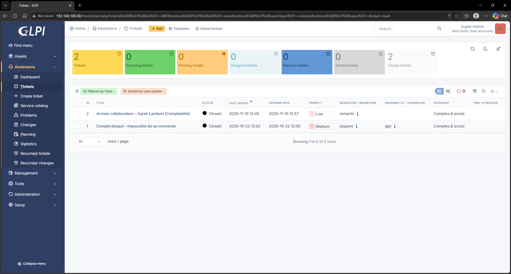

---

## Architecture

```
                 Hyper-V host (Windows 11 Pro)
                 vSwitch "My_NAT_Switch" + NAT  ->  Internet
                           192.168.100.1
                                 |
     +---------------------------+---------------------------+
     |                           |                           |
   DC1                        GLPI01                      CLIENT1
   Windows Server 2025        Ubuntu Server 24.04         Windows 11
   192.168.100.10             192.168.100.30              DHCP (.100-.200)
   AD DS, DNS, DHCP           Docker: GLPI 11 + MySQL     joined to labo.lan
   Share \\DC1\Compta         LDAP -> DC1 (389)
```

| VM | OS | Role |
|---|---|---|
| DC1 | Windows Server 2025 | Forest `labo.lan`, DNS (reverse zone, forwarders), DHCP, file share with NTFS permissions |
| GLPI01 | Ubuntu Server 24.04 | Docker Engine, GLPI 11 + MySQL (official `glpi/glpi` image) |
| CLIENT1 | Windows 11 | End-user workstation, domain-joined |

## What the scripts automate

**`scripts/Deploy-GLPILab.ps1`** (run on the Hyper-V host, PowerShell as admin)
- Internal switch + NAT + gateway for the lab
- DC1 from a sysprepped differencing disk, static IP, rename
- AD DS forest, DNS reverse zone and forwarders, DHCP scope
- Lab content for ticket scenarios: OUs, service account `svc-glpi`, 5 test users, `G_Compta` group, `Compta` share (wide share permission, strict NTFS), account lockout policy
- CLIENT1 (Windows 11 with vTPM) joined to the domain
- GLPI01 VM ready to boot on the Ubuntu ISO
- Health checks with wait loops (`WaitFor-VM`, `WaitFor-AD`) instead of fixed sleeps, full transcript in `C:\VMs\Logs`

**`scripts/glpi01-setup.sh`** (run inside GLPI01 after the Ubuntu install)
- System update, Docker Engine install
- GLPI 11 + MySQL with Docker Compose (persistent volumes)
- Waits until GLPI answers, then sets the static IP with netplan

## GLPI configuration

- [x] Default accounts secured (`glpi`, `tech`, `normal`, `post-only`)
- [x] LDAP directory connected to Active Directory (`svc-glpi` bind account, `sAMAccountName` login, `objectGUID` synchronization)
- [x] AD users imported into GLPI
- [x] ITIL categories (`Comptes & accès`, `Réseau`) and support groups (`N1 - Helpdesk`, `N2 - Systèmes`)
- [x] Custom **Manager** profile (clone of Self-Service + "Approve a request/incident") for approval workflows
- [x] Ticket scenarios below — all closed
- [x] Knowledge base article written from the Problem root cause

| LDAP test 5/5 green (after fixing WS2025 LDAP signing) | AD users imported | Dashboard |
|---|---|---|
| 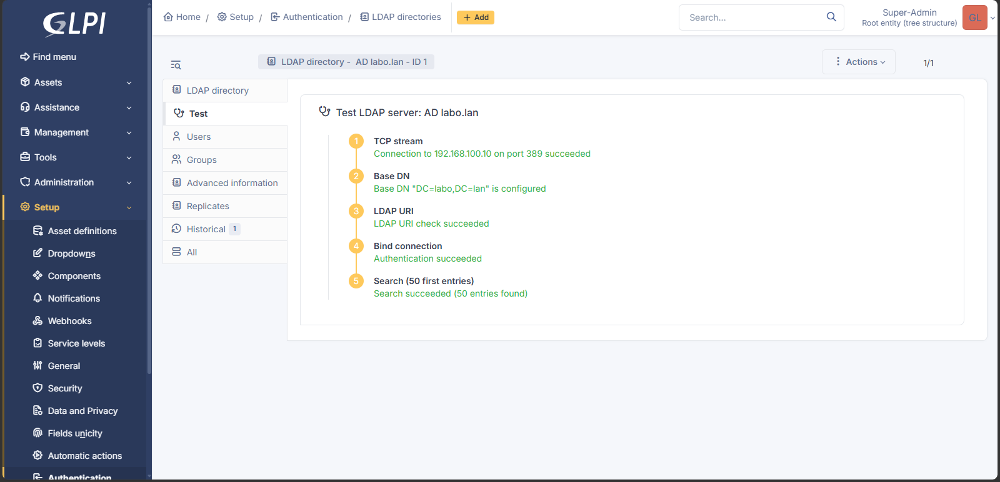 | 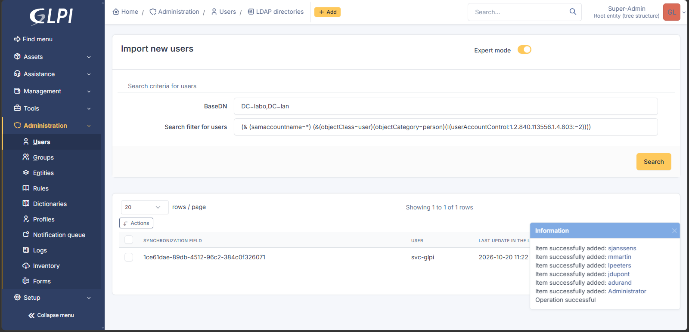 | 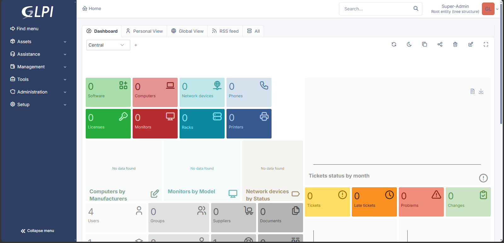 |

## Ticket scenarios (ITIL practice)

Each scenario is broken on purpose in the lab, opened as a ticket by an AD user, fixed for real, and closed with a proper solution note (request, actions, verification). Ticket content is in **French**.

| # | Scenario | GLPI ticket | Type | What it practises | Screenshots |
|---|---|---|---|---|---|
| 1 | Locked account (jdupont) | #1 | Incident | Identity check before reset (private note), AD unlock + temporary password | 01–04 |
| 2 | New hire onboarding (Sarah Lambert) | #2 | Service request | Request opened by the manager, 3 tasks, `New-ADUser` + `G_Compta`, password change at first logon, verification with `whoami /groups` and a write test | 05–11 |
| 3 | "Access denied" on `\\DC1\Compta` (lpeeters) | #3 | Service request | Share vs NTFS permissions, **manager approval in GLPI**, Kerberos token only refreshed after re-logon | 12–18 |
| 4 | "No internet" on CLIENT1 (sjanssens) | #4 | Incident | Bottom-up troubleshooting: IP OK → ping 1.1.1.1 OK → `nslookup` fails → wrong static DNS | 20–26 |
| 5 | 3 users locked again and again | #5, #6, #7 + **Problem #1** | Incidents + Problem | Workaround vs root cause, linked tickets, escalation N1 → N2, event **4740**, forgotten scheduled task, KB article | 27a–35e |
| 6 | Offboarding (Sarah Lambert) | #8 | Service request | Document groups first, disable (not delete), remove groups, move to OU `Desactives`, logon refused | 36–39 |

> Timestamps: tickets 1–3 show UTC (1 h behind) — the timezone was fixed before ticket 4. See the troubleshooting section below.

### 1. Locked account — Incident #1

User calls: account locked. Identity checked first (documented in a **private** note, not visible to the user), then unlock + temporary password with change at next logon.

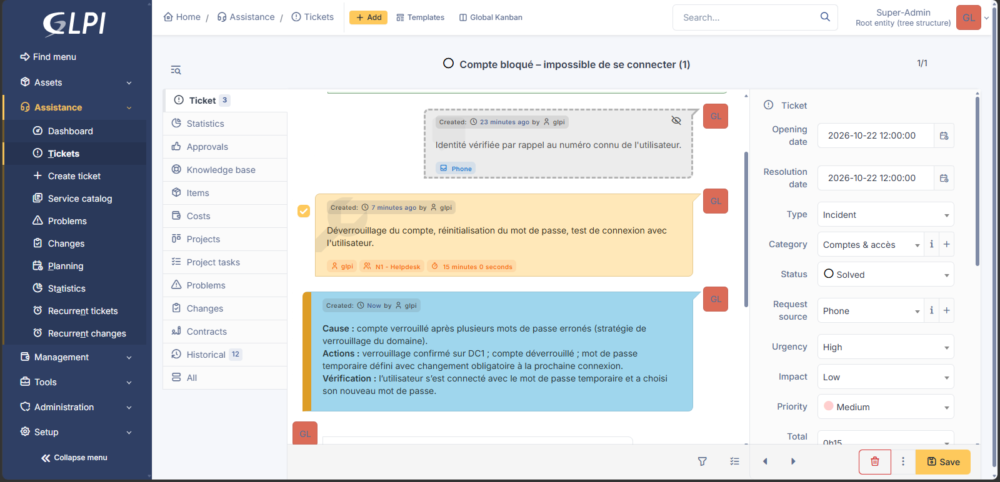

### 2 + 6. A user's full lifecycle — Sarah Lambert, from onboarding to offboarding

**Onboarding (#2).** The request comes from her manager `mmartin`, not from Sarah (she doesn't have an account yet). Split into 3 tasks: create the account, add to `G_Compta`, verify.

| Step | Screenshot |
|---|---|
| Tasks in the ticket | [05](screenshots/05-onboarding-tasks.png) |
| Account created in OU `Employes`, manager and department filled in, password typed with `Read-Host -AsSecureString` (never in clear) | [06](screenshots/06-ad-user-created.png) |
| Group membership | [07](screenshots/07-ad-group-member.png) |
| First logon on CLIENT1 forces a password change | [08](screenshots/08-first-logon-password-change.png) |
| `whoami /groups` shows `G_Compta` / write test on the share | [09](screenshots/09-whoami-groups.png) · [09b](screenshots/09b-share-write-test.png) |
| Solution: request / actions / verification | [10](screenshots/10-onboarding-solved.png) |

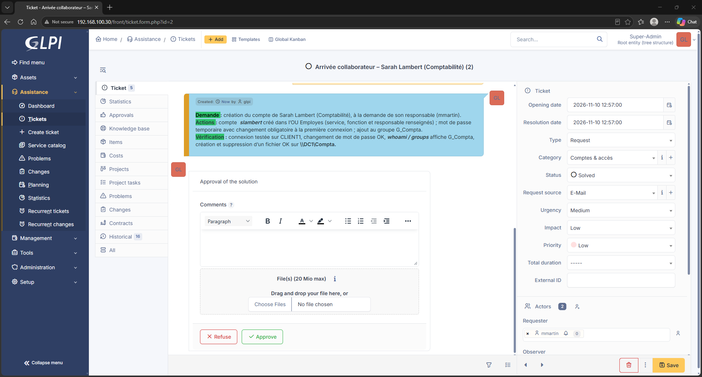

**Offboarding (#8).** Groups documented **before** removing them (so access can be restored if HR made a mistake), account **disabled, not deleted** (keeps the SID and the audit trail), groups removed, moved to OU `Desactives`, description updated with date + ticket number, logon refused on CLIENT1.

| Before | After |
|---|---|
| 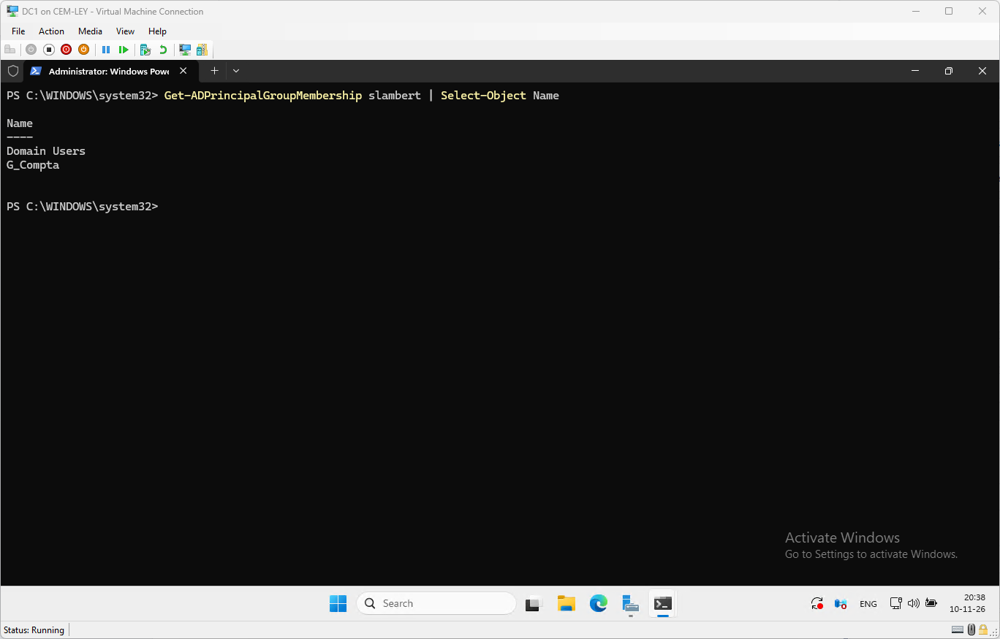 | 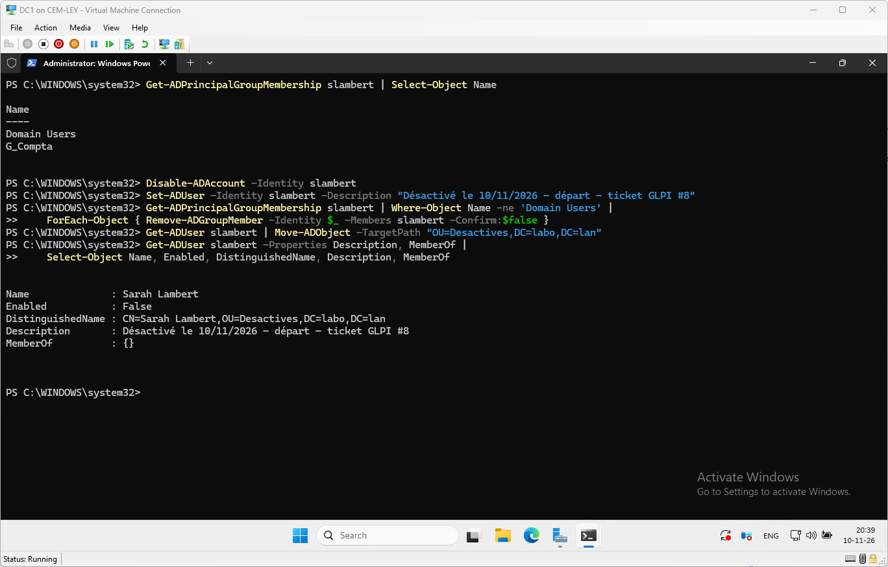 |

More: [ticket](screenshots/36-offboarding-ticket.png) · [account disabled](screenshots/38-account-disabled.png) · [solved](screenshots/38b-offboarding-solved.png) · [closed](screenshots/39-offboarding-closed.png)

### 3. "Access denied" on a shared folder — Request #3

`lpeeters` can't open `\\DC1\Compta`. Diagnosis: the **share** permission is wide (Domain Users: Change) but the **NTFS** permission only allows `G_Compta` (Modify) — the most restrictive wins. Access to a finance folder is a business decision, so the **manager approves in GLPI** before anything changes. After adding the group, access still fails: the **Kerberos token** is only rebuilt at the next logon.

| Step | Screenshot |
|---|---|
| Access denied / permissions diagnosis | [12](screenshots/12-access-denied.png) · [13](screenshots/13-permissions-diagnosis.png) |
| Approval requested → granted by the manager | [14](screenshots/14-approval-requested.png) · [14b](screenshots/14b-approval-granted.png) |
| User added to `G_Compta` | [14c](screenshots/14c-ad-group-added.png) |
| Token not refreshed → refreshed after re-logon → access OK | [15](screenshots/15-token-not-refreshed.png) · [16](screenshots/16-token-refreshed.png) · [16b](screenshots/16b-access-ok.png) |
| Solved / closed | [17](screenshots/17-access-solved.png) · [18](screenshots/18-access-closed.png) |

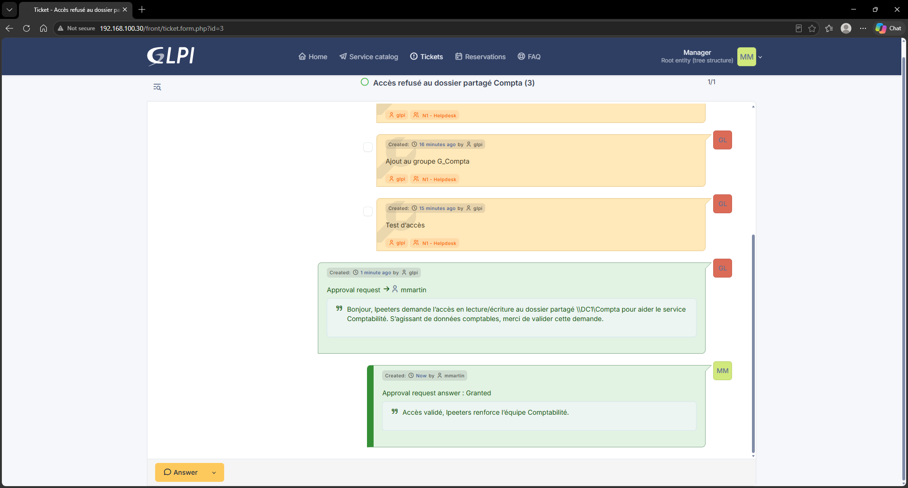

### 4. "No internet" — Incident #4

Bottom-up method, one layer at a time:

1. `ipconfig /all` → IP and gateway OK, **DNS = 192.168.100.99** (wrong static value)
2. `ping 1.1.1.1` → OK, so the network works
3. `nslookup` → fails, so it's **name resolution**
4. Fix: `Set-DnsClientServerAddress -ResetServerAddresses` → back to DHCP (DNS = DC1)

Why not just set 8.8.8.8? A domain PC must use the **domain DNS**, otherwise it can't find the domain controller (logon, GPO and Kerberos all break).

| Wrong DNS | Ping OK, nslookup fails | Fixed |
|---|---|---|
| 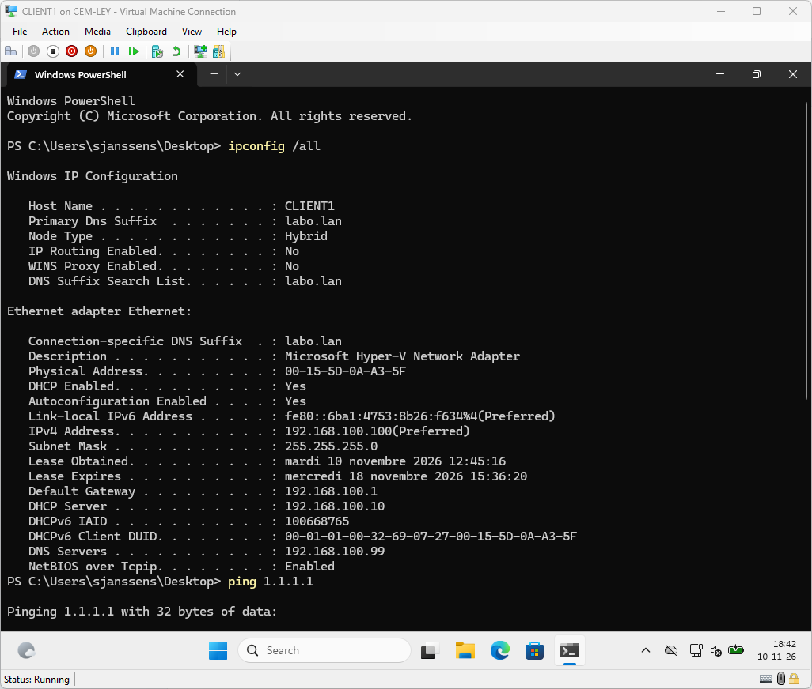 | 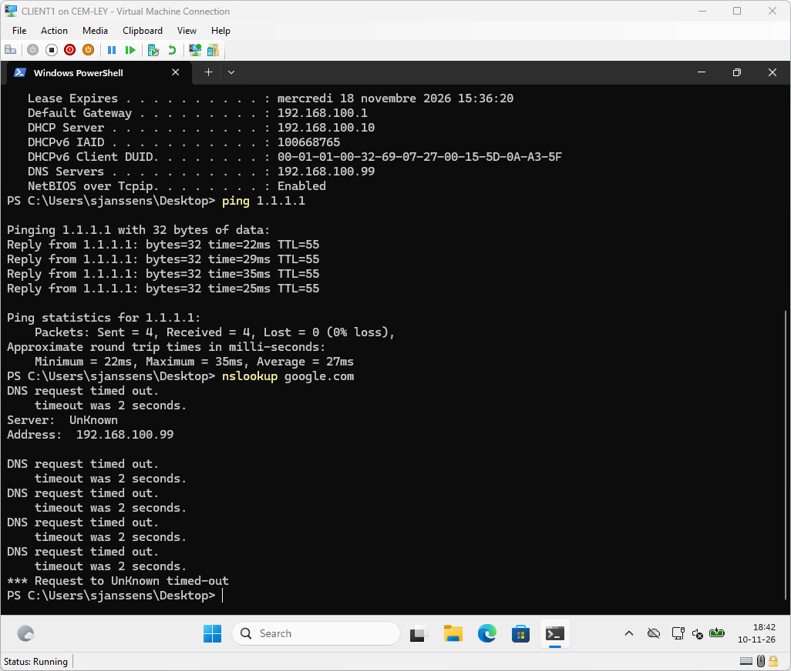 | 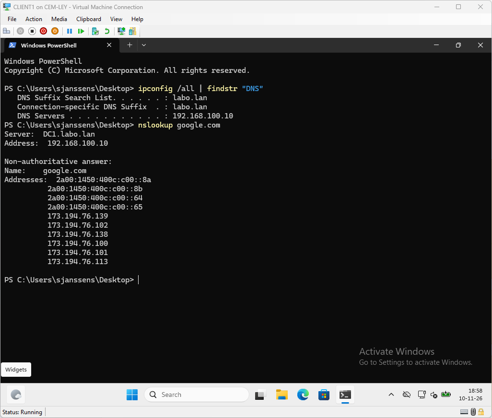 |

More: [ticket](screenshots/20-internet-ticket-open.png) · [tasks](screenshots/23-internet-tasks.png) · [browser OK](screenshots/24b-edge-ok.png) · [solved](screenshots/25-internet-solved.png) · [closed](screenshots/26-internet-closed.png)

### 5. Several users locked again and again — Incidents #5–7 + Problem #1

Three users (`jdupont`, `adurand`, `sjanssens`) call within minutes. **Workaround** first (unlock, reply to users), but the accounts lock again → it's not 3 incidents, it's **one Problem**. Problem #1 is created, linked to the 3 incidents and escalated to **N2 - Systèmes**.

Root cause: event **4740** on DC1 shows the lockout source is **CLIENT1**. On CLIENT1, a forgotten scheduled task `Sync-Compta` keeps connecting with an **old password** every 5 minutes. Task disabled and removed, leftover process stopped, no new 4740 events, accounts stay unlocked. A **KB article** documents the cause for next time.

| Step | Screenshot |
|---|---|
| The fault injected (scheduled task) / 3 incidents | [27a](screenshots/27a-break-scheduled-task.png) · [27b](screenshots/27b-three-incidents.png) |
| Accounts locked → workaround → locked again | [28](screenshots/28-accounts-locked.png) · [28b](screenshots/28b-workaround-followup.png) · [29](screenshots/29-relocked.png) · [29b](screenshots/29b-escalation-followup.png) |
| Problem linked to the incidents, escalated to N2 | [30](screenshots/30-problem-linked.png) · [30b](screenshots/30b-problem-escalated-n2.png) |
| Event 4740 → source CLIENT1 | [31](screenshots/31-event-4740.png) |
| Suspicious task → root cause → removed | [32a](screenshots/32a-suspicious-task.png) · [32b](screenshots/32b-root-cause.png) · [32c](screenshots/32c-root-cause-removed.png) |
| Unlocked, no new 4740, no relock | [33a](screenshots/33a-unlocked.png) · [33b](screenshots/33b-no-new-4740.png) · [33](screenshots/33-no-relock.png) |
| Problem solved + KB article | [34](screenshots/34-problem-solved-kb.png) |
| Incidents and Problem closed | [35](screenshots/35-incident-jdupont-closed.png) · [35b](screenshots/35b-incident-adurand-closed.png) · [35c](screenshots/35c-incident-sjanssens-closed.png) · [35d](screenshots/35d-problem-closed.png) · [35e](screenshots/35e-problems-list.png) |

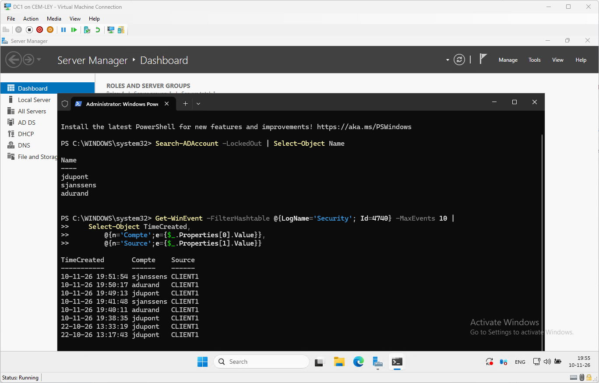

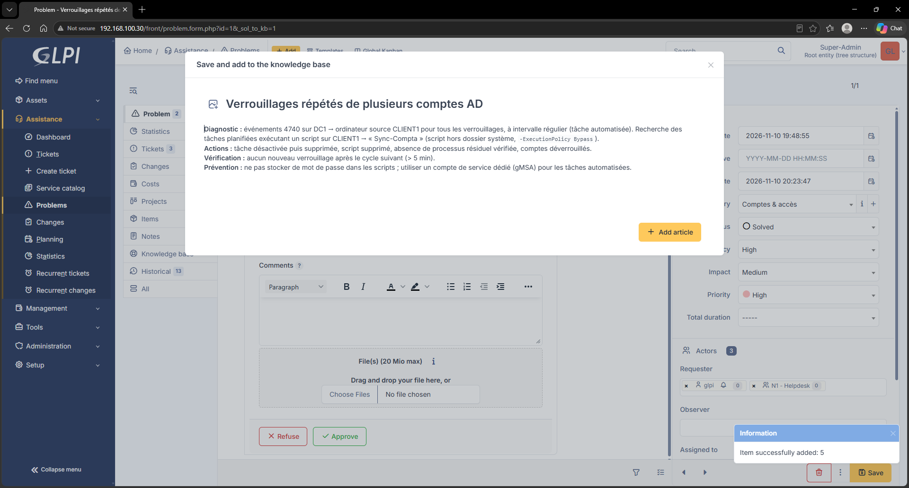

## Troubleshooting — real problems solved during the build

| Symptom | Diagnosis | Cause | Fix |
|---|---|---|---|
| GLPI LDAP test failed | `nc -zv 192.168.100.10 389` succeeded, so not a network issue | **Windows Server 2025 requires LDAP signing by default** on new domains; simple bind on 389 refused | Lab: GPO "LDAP server signing requirements" = None and "...enforcement" = Disabled, `gpupdate /force`. Production: **LDAPS (636) with a certificate** |
| LDAP import found no users | Search filter showed `(uid=*)` | Login field left on `uid` (OpenLDAP attribute) instead of AD's `sAMAccountName` | Login field `samaccountname`, sync field `objectguid`, AD connection filter |
| "Credential is invalid" lines in the deployment transcript | Next line: "DC1 is ready" | Wait loop polling the VM while sysprep was finishing | None needed: errors caught by `try/catch` |
| Possible NAT conflict on redeploy | `Get-NetNat` still listed an old NAT | Deleting a Hyper-V switch does not delete its NAT; Windows supports only one | `Get-NetNat \| Remove-NetNat` |
| Standard user refused on CLIENT1: "you need the right to sign in through Remote Desktop Services" | Admin could log in, standard users couldn't | **Hyper-V Enhanced Session uses RDP** | View > untick *Enhanced session*. User **not** added to Remote Desktop Users (least privilege) — [screenshot](screenshots/08b-enhanced-session-rdp-denied.png) |
| Manager not proposed as approver | His GLPI profile was Self-Service | AD users are imported with Self-Service, which has no approval right | Dedicated **Manager** profile, assigned to `mmartin` only |
| GLPI timestamps 1 h behind | Clock correct and NTP OK, but VM, containers, PHP and MySQL all on **UTC** | No timezone set anywhere in the stack | Checkpoint first, then `timedatectl set-timezone Europe/Brussels`, `TZ=Europe/Brussels` on both containers, `date.timezone` in a mounted `timezone.ini`, `docker compose up -d` (never `down -v`, it deletes the volumes) — [before](screenshots/19a-timezone-before.png) / [after](screenshots/19b-timezone-after.png) |
| Task still running after `Disable-ScheduledTask` | `Get-ScheduledTask` still showed *Running* | **Disable ≠ Stop**: disabling only prevents the next run | Stop the task / kill the leftover process, then verify (no new 4740) |

**Known issue (still open):** the cloned Manager profile can approve requests but not a ticket *solution* — its Assistance rights still need to be compared with Self-Service.

## What I would do differently in production

- **LDAPS** instead of LDAP on 389, rather than relaxing LDAP signing
- Strong unique passwords, a password manager and **MFA** (passwords in this repo are lab-only, see below)
- **HTTPS** in front of GLPI (reverse proxy with a certificate)
- Backups of the Docker volumes (`glpi_data`, `db_data`) and of AD (system state)
- Pinned image versions instead of `latest`
- Service accounts / gMSA for scheduled tasks, so a password change never locks a user again (scenario 5)
- Timezone set in the deployment script from day one

## Skills demonstrated

Hyper-V · PowerShell automation and PowerShell Direct · Active Directory (user lifecycle, groups, OUs, lockout policy) · DNS · DHCP · Group Policy · Share vs NTFS permissions · Kerberos tokens · Windows event logs (4740) · Scheduled tasks · Linux (Ubuntu, netplan, timedatectl) · Docker / Docker Compose · LDAP · GLPI / ITSM · ITIL (incident, service request, approval, problem, escalation N1 → N2, knowledge base) · Bottom-up troubleshooting methodology

## Note on passwords

The passwords in these scripts (`Pa$$w0rd`, the database password) and the "old password" used in scenario 5 are **lab-only**, used in an isolated environment behind NAT. They are not used anywhere else. Never reuse lab passwords in production.
